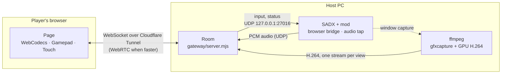

<div align="center">

# SADX Online

**Four-player Sonic Adventure DX, played from the browser.**

One PC runs the game. Everyone else joins from a link: no client, no install.


[Quick start](#quick-start) · [How it works](#how-it-works) · [Usage](#usage) · [Building the mod](#building-the-mod) · [Documentation](#documentation)

</div>

---

## Features

- **Browser seats.** The host always plays as player 1 on the PC. Up to three guests take players 2–4 from
  the browser, with keyboard, gamepad or on-screen touch controls; anyone else watches and can take a seat
  as soon as one frees up.
- **Your own screen.** Each player can watch just their quarter of the split screen, encoded at its own
  resolution, or switch to the full game or another player's view.
- **Low-latency video.** One GPU window capture and H.264 encoder per view, decoded with WebCodecs.
  Flow control skips to the next keyframe instead of building up delay.
- **Game audio.** Captured inside the game process, streamed as Opus and kept in sync with the video.
- **Direct connection.** An optional WebRTC path is used whenever it beats the tunnel.
- **Host panel.** Invite link with QR code, room password, level/act/mode/character selection, kicking
  players, and live per-view and per-viewer stats.
- **Counter-Strike soldiers.** Eight extra characters with Sonic's movement and CS 1.6 weapons; see
  [Counter-Strike soldiers](#counter-strike-soldiers).
- **Chat, emotes and a built-in latency test.**
- **Public link.** Cloudflare Tunnel, either a quick random URL or a fixed hostname.
- **Self-healing.** The game restarts after a crash, and the room restarts without breaking the link.
- **Runs on integrated graphics.** About 0.6 CPU cores in total with a 4-player game and one viewer.
- **Scriptable.** Every action is available from a JSON CLI; see [`AGENTS.md`](AGENTS.md).

## How it works



| Component | Role |
| --- | --- |
| **Room** (`gateway/`) | Node server. Hands out seats, relays input to the game over local UDP, runs one encoder per watched view, turns the game's audio into Opus, and serves the player page and host panel. |
| **Browser bridge** (`mod/src/browser_bridge.cpp`) | Inside the game. Applies each browser seat's input to its player, on top of the host's own keyboard and controllers, and reports the stage, characters, positions and split-screen layout. |
| **Audio tap** (`mod/src/audio_tap.cpp`) | Inside the game. Copies the final mix from the game's WASAPI stream, because Windows' per-process loopback capture only hears silence from SADX. |
| **Base mod** (`mod/sadx-multiplayer/`) | Local multiplayer and split screen. It is built with [`mod/sadx-multiplayer.patch`](mod/sadx-multiplayer.patch) applied, which wires in the two parts above. |

## Requirements

**Host**

| | |
| --- | --- |
| OS | Windows 10 version 2004 or later |
| Game | Sonic Adventure DX (Steam), converted with the [SADX Mod Installer](https://sadxmodinstaller.unreliable.network/) |
| GPU | Integrated graphics are enough. Hardware encoding through NVIDIA NVENC or AMD AMF (both tested, including a Radeon 780M iGPU), or Intel Quick Sync (implemented, not yet tested). Falls back to software encoding. |
| Tools | Git, Node.js 22+, ffmpeg 8+, cloudflared and GitHub CLI. The installer gets any that are missing through winget. |
| Access | A GitHub account with access to this repository |
| Optional | Counter-Strike 1.6 (Steam), for the soldiers' models and sounds |

**Players:** any current browser. Browsers with WebCodecs get H.264 video; others fall back to JPEG at up
to 20 fps.

## Quick start

1. **Prepare the game.** Convert your Steam copy of SADX with the
   [SADX Mod Installer](https://sadxmodinstaller.unreliable.network/), then open SA Mod Manager once.
2. **Clone the repository.**
   ```powershell
   gh repo clone LemonMantis5571/SADX-Multiplayer-Online
   ```
3. **Install.** Run `SADX-Online-instalar.cmd` and point it at your SADX folder. It installs the missing
   tools, downloads the latest mod release, enables it, and tunes the Mod Loader profile for streaming
   (1280 × 960 window, Direct3D 9, keeps running without focus). Anything it changes is backed up first.
4. **Play.** Run `SADX-Online.cmd`. It opens the room, the game and the host panel, and prints the link to
   share. `SADX-Online-cerrar.cmd` shuts everything down.

Run the installer again at any time: it skips what is already in place and installs a newer mod release if
there is one. On weak integrated graphics, run `node gateway/agent-cli.mjs setup --sadx "<SADX folder>" --light`
for a 960 × 720 window.

## Usage

All commands run from the repository root and print JSON, or plain text with `--human`.

| Command | Description |
| --- | --- |
| `node gateway/agent-cli.mjs up` | Starts the room, the game and the public link, and opens the host panel. |
| `node gateway/agent-cli.mjs down` | Closes the link, the game and the room. |
| `node gateway/agent-cli.mjs setup --sadx <dir>` | Installs or updates the mod and tunes the game. `--light` sets a smaller window. |
| `node gateway/agent-cli.mjs doctor` | Checks Node, the room, the video pipeline and the mod. |
| `node gateway/agent-cli.mjs capture <file.jpg>` | Saves a frame of the game window. |
| `node gateway/agent-cli.mjs room restart` | Restarts the room, keeping its code, port and public link. |
| `node gateway/agent-cli.mjs test` | Runs the smoke tests on port 8199 (no game needed). |

The full CLI reference, including the JSONL mode for agents, is in [`gateway/README.md`](gateway/README.md).

**Default keyboard controls in the page**

| Action | Keys | | Action | Keys |
| --- | --- | --- | --- | --- |
| Move | `W` `A` `S` `D` | | A / B / X / Y | `J` or `Space` / `K` / `U` / `I` |
| Camera (right stick) | Arrow keys | | LB / RB | `Q` / `E` |
| Start | `Enter` | | LT / RT | `Shift` / `O` |
| Chat | `T` | | Sound | `M` |
| Switch view | `V` | | Fullscreen | `F` |

## Counter-Strike soldiers

Eight Counter-Strike 1.6 player models join the character list: Phoenix, Elite Crew, Arctic and Guerilla for
the terrorists, GIGN, GSG-9, SAS and SEAL for the counter-terrorists. They run and jump like Sonic and fight
with guns instead of his attacks. Pick one like any other character, from the host panel or with "Quiero ser"
in the page.

| Button | Page key | Host PC key | Action |
| --- | --- | --- | --- |
| X | `U` | `A` | Fire. Hold it with the rifle for automatic fire. An empty clip reloads. |
| B | `K` | `Z` | Next weapon: rifle (AK-47 for terrorists, M4A1 for counter-terrorists), AWP, Desert Eagle, knife |
| Y | `I` | `S` | Throw an HE grenade. Each soldier carries three and gets one back every ten seconds. |
| A | `J` or `Space` | `X` or `Space` | Jump |

The host PC's keys are the Mod Loader's defaults, where the `A` key is the X button: it fires, it doesn't jump.
`Space` jumps on both, for every character, unless the Mod Loader's keyboard settings already use it.

The AWP goes through every enemy in its line of fire, and grenades launch enemies into the air. Each kill is
credited to the player who made it. In battle mode the weapons hit the other players.

The models and sounds come from the host's own Counter-Strike 1.6. This repository and its releases contain
no Counter-Strike files. `setup` finds the game in any Steam library, or takes `--cstrike "<Half-Life folder>"`,
and saves the folder in `mods\sadx-multiplayer\sadx-online.ini`. The mod reads the GoldSrc models (MDL
version 10) and WAV sounds straight from that folder. Without Counter-Strike, the soldiers are silent box
figures with the same weapons.

## Performance

Measured on the development machine (Ryzen with Radeon 780M iGPU and RTX 3060 Ti), with a 4-player game and
one viewer:

| | CPU |
| --- | --- |
| SADX | 0.4–0.5 cores |
| Video, per view (NVENC / AMF) | 0.05–0.07 / 0.06–0.12 cores |
| Room (Node) | ~0.03 cores |
| **Total** | **~0.6 cores** |

Button-to-image latency on the host machine is about 70 ms with NVENC and about 110 ms with AMF.

| View | Default |
| --- | --- |
| Full game, high | 720p, 60 fps, 4 Mbps |
| Full game, low | 480p, 30 fps, 1.2 Mbps |
| Player screen (p1–p4) | 480p, 60 fps, 2.5 Mbps |

A view is encoded only while someone watches it. Host upload grows with each viewer.

## Building the mod

Releases already contain the built mod, so building is only needed when you change it.

**Prerequisites:** Git and Visual Studio 2022 or its Build Tools with the C++ workload.

```powershell
winget install --id Microsoft.VisualStudio.2022.BuildTools -e --override "--quiet --wait --add Microsoft.VisualStudio.Workload.VCTools --includeRecommended"
powershell -ExecutionPolicy Bypass -File mod\build.ps1
```

`build.ps1` does the following:

1. Fetches the base mod submodule and its own submodules.
2. Applies `mod/sadx-multiplayer.patch`, or detects that it is already applied.
3. Downloads the DirectX 8 headers and verifies their SHA-256.
4. Builds `libmodutils`, `ModLoaderCommon` and the mod (Release, Win32, v143) into `mod/.build/`.
5. Packages `dist/mods/sadx-multiplayer/` and `dist/sadx-online-mod.zip`.

To install your build, close the game and run `node gateway/agent-cli.mjs setup --sadx "<SADX folder>"`.
A local build takes precedence over releases; delete `dist/` to go back to releases.

### Releasing

Bump `Version` in `mod/mod.ini`, build, and upload the package. Hosts pick it up the next time they run the
installer or `setup`.

```powershell
gh release create mod-v<version> dist/sadx-online-mod.zip --title "Mod <version>" --notes "..."
```

### Changing the base mod

After a build, `mod/sadx-multiplayer` has the patch applied. Edit it there, then regenerate the patch:

```powershell
git -C mod/sadx-multiplayer diff --ignore-submodules > mod/sadx-multiplayer.patch
```

To move to a newer base commit, discard the applied patch (`git -C mod/sadx-multiplayer checkout -- .`), check
out the commit inside the submodule, rebuild (refreshing the patch if it no longer applies) and commit the
new submodule pointer.

### Checking the base mod's addresses

The base mod calls and hooks game functions by raw address, and a wrong one crashes only when that code runs.
`mod/tools/audit_addresses.py` checks every declaration against your `sonic.exe`: that each address is a
function start, that the registers a usercall passes are the ones the function reads, and that no address
carries two names. Run it after changing the patch or the base mod's commit:

```powershell
py -3 -m pip install capstone pefile
py -3 mod/tools/audit_addresses.py "<SADX folder>\sonic.exe" mod/sadx-multiplayer/source
```

### Fixes in the patch

Besides wiring in the bridge and the audio tap, the patch fixes these bugs in the base mod, all verified by
disassembling `sonic.exe`:

- **Casinopolis crash** (`SADX has crashed at 5cb9b1`). `InitKuzu` pointed at `IsRangeIn` (`0x5CB9B0`), so
  the game crashed whenever a player came near a sewer fan in multiplayer. It now points at the real
  function (`0x5CB650`). The crash was reproduced with the old build and is gone with the new one.
- **Twinkle Park split screen.** `TwinkleMaskBlock` pointed at Speed Highway's function (`0x60FEE0`), so
  split screen picked which parts of the level to draw from another level's thresholds. It now uses
  `0x61CDE0`.
- **Metal Sonic.** Character 8 indexed past the base mod's table of eight characters, so picking him created
  a broken player that crashed or froze the game. He is now Sonic with the game's `MetalSonicFlag` turned on
  only while his own code runs (update, display, destruction and his after-images), so each player can pick
  him on their own.
- **`CCL_Enable`** was declared on the function's final `ret` (`0x41C213`); it starts at `0x41C1F0`.

## Repository layout

```text
.
├── gateway/                  Room server, player page, host panel and CLI
│   ├── server.mjs            Room server
│   ├── agent-cli.mjs         CLI: up/down, setup, doctor, capture, tests, JSONL mode
│   ├── lib/                  Video (capture, encoders), audio, WebRTC, game process
│   ├── web/                  Page and panel source (React, Vite, Tailwind, shadcn/ui)
│   ├── public/               Built pages (committed)
│   └── test/                 Smoke tests (port 8199)
├── mod/
│   ├── src/                  Browser bridge, audio tap, Counter-Strike soldiers (src/cs)
│   ├── sadx-multiplayer.patch
│   ├── build.ps1             Build and package
│   ├── mod.ini
│   └── sadx-multiplayer/     Base mod (submodule, pinned)
├── SADX-Online.cmd           Start
├── SADX-Online-cerrar.cmd    Stop
├── SADX-Online-instalar.cmd  Install or update
└── AGENTS.md                 Step-by-step setup for AI agents
```

`dist/` and `mod/.build/` are build outputs and are not tracked.

## Documentation

| Document | Contents |
| --- | --- |
| [`gateway/README.md`](gateway/README.md) | Room, video pipeline, audio, WebRTC, host panel, page and the full CLI reference (Spanish) |
| [`AGENTS.md`](AGENTS.md) | Install-and-run procedure for AI agents, with checks and troubleshooting (Spanish) |

## Known limitations

- Host upload grows with each viewer: about 4 Mbps on high quality and 2.5 Mbps for a player screen. For
  slower connections, viewers can pick low quality in the page, or the room can lower `--bitrate` and
  `--player-bitrate`.
- The direct WebRTC path has only been tested on a single machine. If it does not connect, the page stays on
  the tunnel.
- Intel Quick Sync encoding is implemented but untested.
- All four players share one SADX instance, so "your screen" is that player's part of the split screen, not a
  separate camera.

## Acknowledgments

- The base mod is [SADX Multiplayer](https://github.com/kellsnc/sadx-multiplayer) by Kell and Sora.
- [SADX Mod Loader](https://github.com/X-Hax/sadx-mod-loader) by X-Hax, and [ENet](https://github.com/lsalzman/enet).
- DirectX 8 headers © Microsoft, fetched at build time and not stored in this repository.

## License

Private repository, not for redistribution. The base mod is published without a license, so this repository
and its releases, which include the compiled mod, must stay private.
